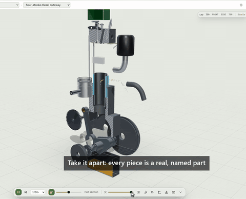

# Solidify

**[solidify.studio](https://solidify.studio)** — engineering in 3D: machines you can run, cut open and take apart, models built from a description, and all of it in a VR headset.



## What it does

- **Labs.** 95 hand-built rigs across 16 systems: engines, power train, hydraulics, steering, traction, implements, machine elements, mechanisms, strength of materials, thermal plant, technical drawing and more. Each one runs on its own physics. Cut it at any angle (cut faces are hatched by material, moving parts stay whole), take it apart, X-ray the casing, and read the numbers as they change.
- **Create in 3D.** Describe a machine in words, or upload a photo, and Solidify builds a working model: parts placed by how they join, sizes you can change, loads drawn on it and the calculations worked. The model's output is checked before you see it (every part held, the mechanism moves freely, the loads act the right way) and repaired when it fails.
- **Read notes in 3D.** Upload lecture notes and their figures become models you can turn, cut and test.
- **Study tools.** Paste a question and see it solved in 3D with the working; exam practice with fresh numbers and method marks; a formula sheet; classes and papers for teachers.
- **VR.** Any lab or model opens in a Quest headset through WebXR, with nothing to install: on the table in front of you or beside you at real size, worked with your hands.
- **An open format.** Models save as `.slfy` files: plain JSON holding the parts, how they join and move, the parameters and the calculations. The specification, schema and examples are public at [slfy.solidify.studio](https://slfy.solidify.studio) ([repository](https://github.com/HectorGitt/slfy)); a copy is staged here in `format/`.

## Stack

- **Web:** Vite, React 19 and TypeScript; three.js through @react-three/fiber and drei; WebXR for the headset; zustand, uPlot, KaTeX and Tailwind 4
- **Geometry:** three-bvh-csg builds cut-away and boolean geometry in a web worker
- **API:** Hono on Node, Firestore and Firebase Auth, with Gemini on Vertex AI building and checking the models
- **Tests:** vitest, with over 1,400 tests in the web app (physics, kinematics, model checks) and over 100 in the API

## Repository

| Folder | What | Deploys to |
|---|---|---|
| `web/` | The Solidify app | Netlify, from `main` (see `netlify.toml`) |
| `api/` | The API: accounts, progress, classes, shared links, the model library and its review, and the calls to Gemini | Google Cloud Run |
| `format/` | The `.slfy` format: specification, JSON Schema and examples, generated from the app's own schemas | The public [slfy](https://github.com/HectorGitt/slfy) repository |
| `docs/` | The build log: every problem met while building, with its cause, fix and lesson | |

`web/` and `api/` are independent packages; each has its own `package.json`.

## Develop

```bash
cd web
npm install
npm run dev        # http://localhost:5173
npm test           # physics, kinematics and UI tests
npm run build      # type-check and production build to web/dist/

cd ../api
npm install
npm test           # API tests (in-memory database, fake sign-in and model)
npm run build      # compile to api/dist/
```

The web app runs without the API: the labs need nothing but the browser. Signing in, Create in 3D and the study tools need the API and a Google Cloud project of your own.

## App layout (`web/src/`)

| Path | Contents |
| --- | --- |
| `modules/<system>/<rig>/` | One folder per lab rig: the scene, its model and physics, its geometry and its side panel. Rigs are discovered automatically. |
| `parts/lib/` | The shared parts library: gears, bearings, shafts, brakes, joints, wheels and more, built procedurally. |
| `physics/` | Typed engineering formulas with unit tests. |
| `core/` | The kinematic drive-graph solver and the simulation clock. |
| `render/` | Cut-aways (the section-cap shader), materials, exploded and X-ray views. |
| `note3d/` | Models built from a description: the schema, assembly by relation, kinematics, the checks, and the `.slfy` reader and writer. |
| `evals/` | The scoring of generated models and the faults that keep one out of the library. |
| `xr/` | The headset: placing a model, the hand-worked control panel, real size and table size. |
| `study/` | Questions, exam practice, formulas, classes and papers. |
| `cloud/` | Everything that talks to the API: accounts, Create in 3D, the library and the admin review page. |
